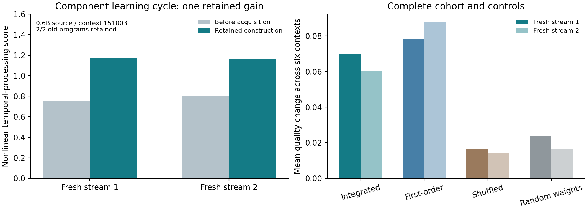

What if a pretrained model contains useful computation that its usual way of operating does not make accessible?

We normally encounter a language model through a familiar workflow: text enters, the transformer processes it, and a language-generation head produces token predictions. That workflow is a way to use the pretrained computation. It need not define everything we can do with it.

**Our research asks what happens when we separate the pretrained neural body from that usual workflow, and acquire a different execution system around it.**

Think of lifting a heavy rock and discovering the activity underneath. The rock, in this analogy, is the assumption that a pretrained model must always be used through the interface it arrived with. Lifting that assumption lets us investigate what other computations can be constructed from the same trained substrate.

With Dr. Paul Attie, I am pursuing this through [Shaping Gap Benchmark](https://github.com/calysteon/shaping-gap-benchmark). Checkpoint 04 demonstrated a learning-and-reuse cycle around a complete pretrained transformer body. **Checkpoint 05 now brings that cycle into a component runtime that executes no original transformer graph.** It acquires an execution change and a shared interface for existing programs, learns which pair to retain, and validates it on untouched inputs.

The larger objective is **capability growth through better organization of computation we already have**. If useful improvements can accumulate economically, some capability growth could become less tightly coupled to bigger pretrained models and expanding data-centre capacity.

<a class="research-button" href="https://github.com/calysteon/shaping-gap-benchmark/tree/04870c5ff60838dde856e03687524721910cda5c/checkpoints/05-component-learning-cycle">Explore Checkpoint 05</a>
<a class="research-button research-button-secondary" href="https://github.com/calysteon/shaping-gap-benchmark/blob/04870c5ff60838dde856e03687524721910cda5c/checkpoints/05-component-learning-cycle/paper/shaping-gap-benchmark-v.pdf">Read Paper V</a>

## November 13 update: the learning cycle now runs on neural components

The latest experiment uses **24 selected pretrained neural fragments per context** as its computational substrate. A new recurrent runtime connects them directly. It executes their native numerical functions without invoking transformer blocks, attention, tokenization or a language-generation head.

The system acquires response interfaces from component behavior and partial derivatives. It uses those interfaces to anticipate how one component's output changes the response of another. Actual neural execution produces the result; experience then selects an execution change together with a shared compatibility interface to retain.

In one 0.6B-derived context, scores on two untouched input streams improve:

| Numerical processing score | Before acquisition | Retained construction |
|:--|--:|--:|
| Fresh stream 1 | 0.75648 | **1.17401** |
| Fresh stream 2 | 0.79913 | **1.16017** |

The shared interface preserves **both eligible old programs**, versus one under direct reuse. Across all six pretrained contexts using integrated guidance, one update and five baseline fallbacks produce positive mean score changes in both streams, with **18/18** old program instances retained.

<figure>

<figcaption>Paper V reports all 24 model/context/control conditions. Absolute gains are shown because score scales differ across these experimental runtimes.</figcaption>
</figure>

The controls help locate the contribution. First-order guidance produces two strict successes; shuffled-conditioning and matched random-weight components produce one each. The result establishes an **acquisition and compatible-reuse cycle after replacing the original transformer graph**. The complete comparisons are in [Paper V](https://github.com/calysteon/shaping-gap-benchmark/blob/04870c5ff60838dde856e03687524721910cda5c/checkpoints/05-component-learning-cycle/paper/shaping-gap-benchmark-v.pdf).

The [checkpoint package](https://github.com/calysteon/shaping-gap-benchmark/tree/04870c5ff60838dde856e03687524721910cda5c/checkpoints/05-component-learning-cycle) includes extracted component banks, executable code, every experimental condition and an independent replay of 1,440 score vectors. It runs on a CPU without downloading the full source language models. Numerical materialization differences from the original mixed-precision components, preparation work and resource costs are documented alongside the results.

This brings the training-scaffold idea into an executable experiment: selected functions acquired during transformer pretraining can participate in a different computation, and that computation can undergo a measured learning-and-retention cycle. The next step is another acquisition from the accepted component runtime, extending what it can do while preserving the first improvement.

## Checkpoint 04: separating computation from language generation

In Checkpoint 04, tokenization, English prompts and the language-generation head are outside the execution path. Continuous numerical state enters the pretrained body directly. We observe its neural response and acquire connections that return that response as the next recurrent state.

**The complete transformer body still executes: all 28 blocks and final normalization.** Its attention and feed-forward operations, with their frozen pretrained weights, supply the computation. We have separated the substrate from its usual language-generation workflow; the experiment does not remove the transformer operations or their computational cost.

This distinction makes the opportunity concrete. We can change how the same neural body is driven, how its response feeds the next invocation, and how programs access the resulting activity.

The method goes beyond recording activations. It acquires return connections from measured neural response geometry, changes the recurrent computation, and evaluates whether the change is worth retaining. A shared observation interface is acquired from paired trajectories so that unchanged readout programs can continue to consume the reorganized computation.

Our central contribution is the acquired pair and the learning-and-reuse cycle around it:

> Acquire an executable reorganization of frozen pretrained computation together with a shared interface for existing programs; learn which pair to retain from experience; then validate improvement and backward compatibility on fresh inputs.

The retained object is the **execution change plus its compatibility interface**. The quality of the new computation and the usability of the old programs are tested together.

This builds on established work in [frozen transformer reuse](https://arxiv.org/abs/2103.05247), [learned execution morphology](https://arxiv.org/abs/2610.38382), and [backward-compatible representations](https://arxiv.org/abs/2206.03040). Our contribution is the native-response-derived execution/interface construction and its closed acquisition, selection and fresh-reuse protocol, with quality, retention and costs evaluated together.

## The Checkpoint 04 result

In Checkpoint 04, experiential feedback selected five update/interface pairs across twelve runtime contexts. Seven contexts retained the baseline. All choices were locked before two untouched validation streams; no pretrained weights, readout programs or observation interfaces were refitted during that final validation.

Two contexts met the strict joint criterion: at least 1% quality improvement on **both** fresh streams, with every eligible old program retained.

| Frozen model and context | Fresh-stream quality gains | Old programs with the shared interface | Direct reuse without the interface |
|:--|:--|:--|:--|
| 0.6B / 111005 | **+3.95%, +4.39%** | **13/13** | 9/13 |
| 1.7B / 111004 | **+5.09%, +4.96%** | **18/18** | 10/18 |

These percentages measure a finite **nonlinear temporal-processing score**: how well linear readouts recover nonlinear relationships across input history. The assay has 143 functions, including 109 multi-lag nonlinear targets. They are benchmark processing-quality gains, rather than percentages of chatbot intelligence or customer revenue.

<figure>

<figcaption>Two strict fresh-reuse successes, alongside retention for the full twelve-context cohort. The complete paper and data include every selected update, fallback and regression.</figcaption>
</figure>

Across **all twelve contexts**, pooled mean score changes were positive in both fresh streams, and **140 of 141 old program instances remained usable**, versus 116 without the shared interfaces. Four selected updates improved quality on both streams with full retention; two passed the stricter 1% threshold in both. One selected update regressed and lost a program. The smaller-model aggregate was mixed across the streams.

The positive result is learning and reuse within experienced runtime contexts. A separate predictor tested on unseen runtime geometry missed its aggregate transfer criterion. The selected updates also did not cross the stronger newly reliable nonlinear-function threshold across all four feedback and validation blocks. These distinctions are part of the [complete results](https://github.com/calysteon/shaping-gap-benchmark/blob/61fd80fbe76b83a87d465c5dea046fca65637834/checkpoints/04-experience-acquired-reuse/results/report/FEEDBACK-RESULTS.txt).

All neural execution was local, using ordinary four-bit pretrained models on an Apple M4 Max with 36 GiB of memory. Independent checks reproduced **5,040 saved native outputs bit exactly**, alongside 1,008 score vectors and 387 acquisition/retention seals. The publication includes the source, frozen programs, trajectories, protocols and replay commands.

## A different unit of commercial progress

The commercial opportunity follows from the separation: an organization could develop useful new execution over an installed pretrained core, while keeping the programs built on that core usable. The unit of improvement becomes a retained executable construction and its interface.

A model is often one component in a much larger installed system. A better representation can still be an expensive upgrade if every dependent consumer has to be retrained or recalibrated.

This is an established industrial problem. [Learning Backward Compatible Embeddings](https://arxiv.org/abs/2206.03040), from researchers at Amazon and Stanford, describes how embedding updates can force consumer teams to retrain their models or continue maintaining historical versions. The study evaluates compatibility on a real-world recommendation application.

Our commercial research hypothesis is that **capability acquisition and compatibility should be engineered as one upgrade process**.

That could create three kinds of value:

- **More useful work from an installed deployment.** Acquire additional processing ability while retaining the existing pretrained core and measuring the added runtime resources.
- **Lower upgrade and integration costs.** Keep existing consumers usable as the runtime improves, reducing the downstream work required to adopt an improvement.
- **Reusable capability packages.** Retain, version and deploy validated execution/interface constructions for particular tasks or operating contexts.

The product direction would be a capability-development runtime for organizations that control their neural deployments: an engine that discovers candidate constructions, evaluates their gains and compatibility, and maintains accepted improvements. Commercial viability would depend on the resulting workload economics, reliability and maintenance effort.

A direct application study would be industrial time-series monitoring: acquire detection of a new operating or fault pattern while keeping existing detectors and forecasts usable. That connects our numerical recurrent mechanism to a concrete operational outcome.

## The sustainability opportunity

The physical stakes are substantial. The IEA's [2026 energy-and-AI outlook](https://www.iea.org/reports/key-questions-on-energy-and-ai/executive-summary) projects data-centre electricity demand rising from about 485 TWh in 2025 to 950 TWh in 2030. That projection covers data centres broadly, with AI-focused demand growing particularly quickly.

Our long-term objective is **capability growth through acquired organization over an existing substrate**. If successive improvements can be retained and their discovery costs amortized, some capability growth could come from reorganizing installed computation without requiring a larger pretrained model at every step.

That would provide another lever for sustainable AI: extend the useful work delivered by existing hardware, reuse the investment embodied in pretraining, and reduce the upgrade pressure that can accompany new capability demands.

The environmental claim has to be measured over the lifecycle. Unchanged model weights are not an electricity measurement. Discovery, unsuccessful trials, validation, extra execution, storage and maintenance all consume resources. Checkpoint 04 records **1,852,268 new two-position native sequences**, including independent verification, with historical acquisition and an additional 7,680 publication-validation sequences recorded separately. Electrical energy has not been measured in either checkpoint. The complete [Checkpoint 05 ledger](https://github.com/calysteon/shaping-gap-benchmark/blob/04870c5ff60838dde856e03687524721910cda5c/checkpoints/05-component-learning-cycle/results/cost-ledger.json) separately records its component execution, preparation and validation work. Measured lifetime energy is the next sustainability criterion.

The commercial and sustainability target is therefore precise: **lower lifetime cost and energy per retained useful capability**, at the required quality and regression limits. Deployment volume matters too; a lower cost per capability does not by itself determine the total footprint as usage expands.

## Could a smaller substrate outperform a larger model?

That is a compelling hypothesis to test: a smaller pretrained body with an acquired execution system could outperform a larger model on specified capabilities. Model size and the quality of its execution system are different experimental variables.

The current result establishes improvement relative to the same frozen substrate under the benchmark's baseline runtime. The smaller-versus-larger question calls for its own comparison: matched tasks and quality criteria, with acquisition work, inference work, memory and energy accounted for on both sides.

The next research step toward cumulative growth is to start from the accepted component runtime, acquire a second improvement, and test whether it preserves the first. Shared compatibility maps can be composed into a fixed-size map; the experiment must charge the work of acquisition, rejection and maintenance as that process continues.

For commercial evidence, I would then test a sequence of useful upgrades on a real workload, measuring task quality, old-program retention, peak memory, latency, energy and total acquisition cost against replacement and adaptation alternatives.

This is where the larger opportunity lives: **an AI installation whose useful capabilities can develop through experience, with retained improvements that make later development more valuable.** The model we trained becomes a substrate for further invention through execution.

The research question is whether that process can repeatedly increase what installed computation can do, while keeping the resource budget and existing obligations explicit. The public benchmark now gives us working first cycles at both whole-body and component levels, with the evidence needed to pursue repeated development.

If you operate a neural workload with expensive upgrades, established downstream consumers and measurable acceptance criteria, I would be interested in exploring that next experiment together.

## Inspect the work

- [Checkpoint 05: component runtime, complete data and reproduction](https://github.com/calysteon/shaping-gap-benchmark/tree/04870c5ff60838dde856e03687524721910cda5c/checkpoints/05-component-learning-cycle)
- [Paper V: Learned Component Execution Beyond the Transformer Graph](https://github.com/calysteon/shaping-gap-benchmark/blob/04870c5ff60838dde856e03687524721910cda5c/checkpoints/05-component-learning-cycle/paper/shaping-gap-benchmark-v.pdf)
- [Checkpoint 05: all results and controls](https://github.com/calysteon/shaping-gap-benchmark/blob/04870c5ff60838dde856e03687524721910cda5c/checkpoints/05-component-learning-cycle/results/FINDINGS.txt)
- [Current benchmark and research history](https://github.com/calysteon/shaping-gap-benchmark)
- [Checkpoint 04: code, data, protocols and reproduction](https://github.com/calysteon/shaping-gap-benchmark/tree/61fd80fbe76b83a87d465c5dea046fca65637834/checkpoints/04-experience-acquired-reuse)
- [Paper IV: Experience-Acquired Execution and Compatibility Reuse](https://github.com/calysteon/shaping-gap-benchmark/blob/61fd80fbe76b83a87d465c5dea046fca65637834/checkpoints/04-experience-acquired-reuse/paper/shaping-gap-benchmark-iv.pdf)
- [All-context results](https://github.com/calysteon/shaping-gap-benchmark/blob/61fd80fbe76b83a87d465c5dea046fca65637834/checkpoints/04-experience-acquired-reuse/results/report/FEEDBACK-RESULTS.txt)
- [Acquisition and lifecycle cost ledger](https://github.com/calysteon/shaping-gap-benchmark/blob/61fd80fbe76b83a87d465c5dea046fca65637834/checkpoints/04-experience-acquired-reuse/results/cost-ledger.json)

*Research by Nathaniel Oh and Paul Attie. This post describes a research result and a commercial development hypothesis; the linked artifacts provide the precise experimental scope.*

## Change log

### November 13, 2026 — Checkpoint 05

- Added the component-level learning-and-reuse experiment, its fresh results and all controls.
- Updated the latest paper/code links and social preview. Retained the dated Checkpoint 04 evidence and its original links.
- Documented numerical fidelity and preparation costs; clarified the next acquisition and energy-measurement questions.
- Research version: [Checkpoint 05 publication](https://github.com/calysteon/shaping-gap-benchmark/commit/04870c5ff60838dde856e03687524721910cda5c).

### November 13, 2026 — Initial publication

- Published the explanation of pretrained computation, the Checkpoint 04 result, and its commercial and sustainability research direction.
- Original article version: [de62ced](https://github.com/calysteon/calysteon.github.io/commit/de62ceddf106e75d7fafd1b5aa5d9e5a0e3e89cb).
