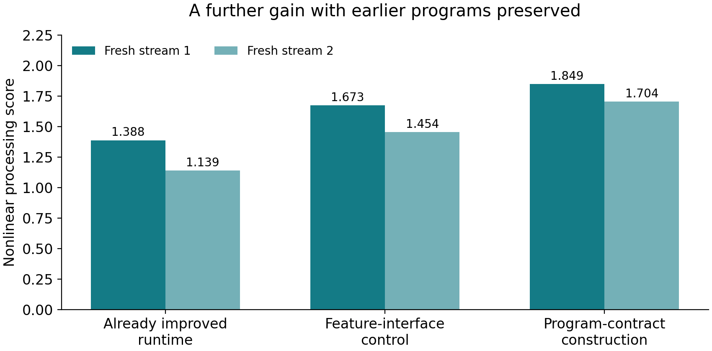

**The Shaping Gap Benchmark improves numerical processing by learning new ways to connect and run components from trained language models. The original weights stay fixed.**

The method measures how individual components respond and uses those measurements to construct new connections. When a new connection changes the outputs, a learned translation keeps them usable by programs built around the earlier computation. Each proposed construction is tested for both improvement and compatibility before it is retained.

In one component-runtime experiment, this process improved a numerical processing score by 33.24% and 49.60% on two untouched input streams, starting from an already improved runtime. All six protected program instances remained usable.

<a class="research-button" href="https://github.com/calysteon/shaping-gap-benchmark">See the code</a>
<a class="research-button research-button-secondary" href="https://github.com/calysteon/shaping-gap-benchmark/blob/734af7274a691fdffc3fe4ffe41c2b433d352f52/checkpoints/06-cumulative-contract-interfaces/paper/shaping-gap-benchmark-vi.pdf">Read the paper</a>

## Separating pretrained computation from its usual workflow

A language model normally receives text, processes it through a transformer, and predicts tokens. Pretraining also leaves behind numerical functions inside its neural components. The method uses those functions in a different execution system.

Our [initial whole-model experiment](https://github.com/calysteon/shaping-gap-benchmark/tree/61fd80fbe76b83a87d465c5dea046fca65637834/checkpoints/04-experience-acquired-reuse) drove the complete frozen transformer body with continuous numerical state and returned its neural response as the next recurrent state. All 28 transformer blocks still executed. Two contexts improved a numerical processing score by approximately 4–5% on both fresh streams while retaining all their eligible old programs. Across the full twelve-context cohort, 140 of 141 old program instances remained usable.

The [component runtime](https://github.com/calysteon/shaping-gap-benchmark/tree/04870c5ff60838dde856e03687524721910cda5c/checkpoints/05-component-learning-cycle) connects 24 selected pretrained neural fragments per context and executes their numerical functions directly, outside the original transformer graph. It uses no attention, tokenization or language-generation head in that execution path.

The runtime acquires descriptions of how components respond to inputs and partial derivatives. These response interfaces help anticipate how one component's output will condition the next component's response. The actual pretrained functions execute the computation, and experience determines which changes to retain.

This builds on research in [frozen transformer reuse](https://arxiv.org/abs/2103.05247), [learned execution morphology](https://arxiv.org/abs/2610.38382) and [backward-compatible representations](https://arxiv.org/abs/2206.03040). The contribution is the acquired execution together with the interface that keeps existing programs usable as that execution changes.

## Improving without breaking earlier work

Changing a runtime can improve its processing while changing the observations its existing programs expect. The method addresses both together: acquire an execution change and a shared compatibility interface, then assess the new computation and the old programs on the same fresh inputs.

The first component-level cycle retained one improvement in six pretrained contexts under integrated guidance, with both eligible old programs preserved in the successful context. Across that cohort, the accepted update and five baseline fallbacks retained 18 of 18 old program instances. First-order, shuffled-conditioning and matched random-weight controls also produced successes; the complete comparisons remain in the linked component study.

The runtime acquires the shared interface against **program contracts**: the numerical functions that unchanged readout programs must continue to compute. Source targets train one shared observation map, with feature anchors and regularization. Earlier program weights stay fixed.

Feedback selects the execution/interface pair. New inputs then determine whether to commit it or roll back. After all acquisition rounds, two untouched terminal streams assess the retained runtime. The reliability and quality requirements for earlier programs remain in force throughout.

## Building on an improvement

In one 0.6B-derived context, the system recruits an additional original pretrained component and retains it with a program-contract interface. The two terminal processing scores change as follows:

| Runtime | Fresh stream 1 | Fresh stream 2 |
|:--|--:|--:|
| Already improved runtime | 1.38792 | 1.13904 |
| Feature-interface control | 1.67273 | 1.45352 |
| Program-contract construction | **1.84921** | **1.70404** |

The program-contract construction improves these scores **33.24% and 49.60%**, with **6/6 protected program instances retained** across three frozen libraries. The feature-interface control also improves, by 20.52% and 27.61%; the interface-only control retains baseline. These are program instances across libraries, rather than six distinct new functions.

The score measures how well linear readouts recover nonlinear relationships across input history, using a suite of 143 functions. The percentages describe finite numerical processing performance. Language-answer accuracy was not evaluated.

<figure>

<figcaption>A second compatible improvement built on an accepted runtime. All controller choices are fixed before the untouched terminal inputs; the paper includes the complete controls, failed proposals and retention results.</figcaption>
</figure>

Both successful arms accept one additional neural acquisition during five rounds. This establishes a two-improvement chain: the original component gain followed by a second retained gain. The stronger criterion of two further acquisitions is not met.

The successful construction retains one additional native port and **one 600-value compatibility map**. Interfaces compose into that same map shape. Conservatively counted runtime/program arrays occupy 1,102,272 bytes under the supplied 8 MiB payload cap. This construction uses one of four available recruitment slots. Replacement within a full active bank is outside the scope of this experiment.

## Recruitment, verification and cost

An initial recruitment study screened pools of 64, 128 and 512 candidates in fixed-size chunks. Fresh terminal gains occurred in 2, 3 and 4 of six inherited contexts. Random-128 and resident-bank controls each succeeded in three contexts. Larger pools offered more opportunities and required more screening work.

That study exposed the preservation bottleneck: it produced no second gain on the already improved chain, even though candidate changes often improved their own processing score. The follow-up acquired the shared interface against existing program requirements, kept the regression guards, and produced the second gain on new streams.

Independent checks cover **12,112 temporal score vectors, 1,109 seals, 300 acquired maps, 8,320 native response points and every application prediction**. Fresh portable acquisition and forecasting reproduce the recorded outcomes exactly. Replay uses the supplied component banks on a CPU, without downloading the complete source language models.

The recruitment, program-contract and application studies took approximately 175, 49 and 5 seconds respectively in the recorded CPU environment. These are whole-study times. The [lifecycle ledger](https://github.com/calysteon/shaping-gap-benchmark/blob/734af7274a691fdffc3fe4ffe41c2b433d352f52/checkpoints/06-cumulative-contract-interfaces/results/cost-ledger.json) records preparation, unsuccessful candidates, interface fitting, validation, retained state and historical work. Whole-process memory is reported separately from retained arrays and the immutable component archive. Numerical materialization differences from the original mixed-precision components are documented in the source provenance.

## Testing application value

We froze the acquired controllers and fitted forecast readouts on a public chronological appliance-energy series. Training used the first 60% of observations, validation the next 20% without tuning, and testing the final 20%. The experiment uses univariate consumption from one house.

One-hour test RMSE fell from **83.1373 to 82.6682 Wh**, a **0.564% reduction**, with a paired daily-block interval of 0.101–1.175%. Ten-minute error rose 2.220%, and four-hour change was very small. A 64-lag ridge autoregression reference performed better at all three horizons.

The application acceptance criterion was not met. The result identifies concrete application requirements: improve the longer-horizon forecast while protecting the short-horizon consumer and competing with the classical reference. Complete predictions, preprocessing, controls and public dataset attribution are included with the code.

## Future work

Application-directed acquisition can use those forecast requirements to guide component and interface selection, with the retained pair evaluated on fresh data. Further studies can assess repeated acquisition and replacement within a full active bank.

The potential commercial value is an upgrade process that develops new capability over an installed pretrained core while keeping existing consumers usable. That could reduce the integration and retraining work needed to adopt an improvement. Demonstrating that value requires competitive application quality and a lifecycle comparison against replacement and adaptation alternatives, including acquisition cost, latency, peak memory and maintenance.

A smaller substrate with better acquired execution could also be compared with a larger model on matched tasks and quality requirements. That experiment would separate model size from execution quality while charging the resources used on both sides.

The sustainability objective is **lower lifetime energy and cost per retained useful capability**. Reusing pretraining and installed hardware could reduce the pressure to expand models and data-centre capacity as requirements grow. Electrical energy and customer savings require separate evaluation, including discovery, failed trials, validation, execution, storage and maintenance.

<a class="research-button" href="https://github.com/calysteon/shaping-gap-benchmark">See the code</a>
<a class="research-button research-button-secondary" href="https://github.com/calysteon/shaping-gap-benchmark/blob/734af7274a691fdffc3fe4ffe41c2b433d352f52/checkpoints/06-cumulative-contract-interfaces/paper/shaping-gap-benchmark-vi.pdf">Read the paper</a>

[Complete results](https://github.com/calysteon/shaping-gap-benchmark/blob/734af7274a691fdffc3fe4ffe41c2b433d352f52/checkpoints/06-cumulative-contract-interfaces/results/FINDINGS.txt) · [Cost ledger](https://github.com/calysteon/shaping-gap-benchmark/blob/734af7274a691fdffc3fe4ffe41c2b433d352f52/checkpoints/06-cumulative-contract-interfaces/results/cost-ledger.json) · [Research history](https://github.com/calysteon/shaping-gap-benchmark/blob/main/CHECKPOINTS.json)

## Change log

- **[Checkpoint 6](https://github.com/calysteon/shaping-gap-benchmark/commit/734af7274a691fdffc3fe4ffe41c2b433d352f52):** A second compatible component acquisition, program-contract interfaces, recruitment scaling and chronological forecasting.
- **[Checkpoint 5](https://github.com/calysteon/shaping-gap-benchmark/commit/04870c5ff60838dde856e03687524721910cda5c):** The learning-and-reuse cycle moves into a runtime over selected pretrained components, outside the original transformer graph.
- **[Checkpoint 4](https://github.com/calysteon/shaping-gap-benchmark/commit/61fd80fbe76b83a87d465c5dea046fca65637834):** Experience-selected execution and shared compatibility around a complete frozen transformer body.
